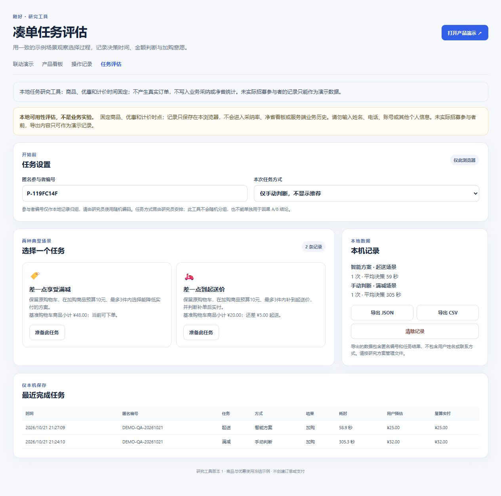

# 本地凑单任务评估验收

日期：2026-10-21（Asia/Shanghai）。入口：[任务评估](http://127.0.0.1:3000/research.html)。本记录验证产品工具与示例计价，不是实际参与者实验报告。

## 本轮交付

- 两个冻结任务：差一点享受满减、差一点到起送价；手动或智能方式由研究员安排，显式开始计时。
- 提交选择后填写实付预估、原本购买意愿和费力度，保存后显示后台复算金额；反馈时间与网络复算耗时不计入决策用时。
- 记录任务版本、固定计价时间、匿名编号、选择、加购内容、金额结果、用时和中断次数；浏览器本地保存，支持 JSON/CSV 导出。
- 复算失败、恢复失败和存储失败均保留重试入口；校验任务版本和损坏进度；按 recordId 分条保存，刷新去重，聚合快照写入失败不丢已落盘记录。
- CSV 保留负数金额，转义公式开头的字符串，可选空值输出空白单元格。

## 自动检查

`prototype/backend` 中执行 `rtk npm test`：64 项测试全部通过，0 失败；API integration 24 groups PASS。执行 `rtk node --check ../research-app.js`：退出码 0。最后一次逻辑修改为 CSV 空值处理，随后完成上述完整检查。

研究部分包含 9 项后端测试和 12 项前端测试，覆盖冻结数据、独立金额复算、非法输入、预算和件数、研究请求不改业务统计、刷新恢复、复算重试、任务版本、存储故障、重复保存、不同页面记录读回与导出等。API 测试使用临时存储和随机端口。

运行中的本机服务版本为 1.3.0；`/health`、`/research.html`、`/research-app.js`、`/api/research/tasks` 实际返回 200。研究样式文件此前的联调及静态资源集成检查也通过。

## 浏览器操作证据

本次只使用匿名演示编号 `DEMO-QA-20261021`，没有招募实际参与者。两条记录的用时含自动化操作和检查停留，不能用于效率比较。

| 场景与方式 | 实际操作 | 金额核对 | 记录结果 |
| --- | --- | --- | --- |
| 满减，手动 | 原车商品 ¥48，添加一份 ¥2 米饭，填预估 ¥32 并保存反馈 | 原实付 ¥35，新实付 ¥32，净省 ¥3 | 保存一条，金额误差 0 |
| 起送，智能 | 原车商品 ¥20，选 ¥5 酸梅汤方案，刷新恢复后提交，填预估 ¥25 并保存反馈 | 原车不可下单，补单实付 ¥25，支付增加 ¥5，净省固定 0 | 保存一条，刷新中断 1 次，金额误差 0 |

两条完成记录在刷新及本机服务重启后仍可读回。页面导出 JSON、CSV 成功；修复空值后重新从运行页面导出的 CSV 已核对，空字段为空白，`paymentChange=-3` 保留负号。

- [演示 JSON](research-demo-records.json)
- [演示 CSV](research-demo-records.csv)
- [实际页面截图](v13-research.jpg)

360 × 800 视口已目视检查页面顶部、说明与设置布局，并已恢复默认视口；本次未对研究页的全部长页面和全部窄屏交互做穷尽验证。

## 使用边界

研究接口不产生真实订单或支付，不创建产品可采纳报价，不写入业务事件、累计净省、历史或主引擎性能窗口。完成记录和活动进度仅保存在当前浏览器，无跨设备同步；请在一个浏览器内顺序运行单个任务，不并行开展多标签任务。导出文件已标明演示身份，不能当作真实研究样本。

当前未完成真实平台规则、库存、账户券资格和支付对账接入，未开展随机分组、真实参与者任务研究或业务 A/B，因此不能声称降低真实用户决策耗时、减少浪费、提升转化率或交易规模。下一步按[技术方案第 8 节](../prototype/docs/TECHNICAL_SOLUTION.md)开展真实规则对账和参与者验证。
